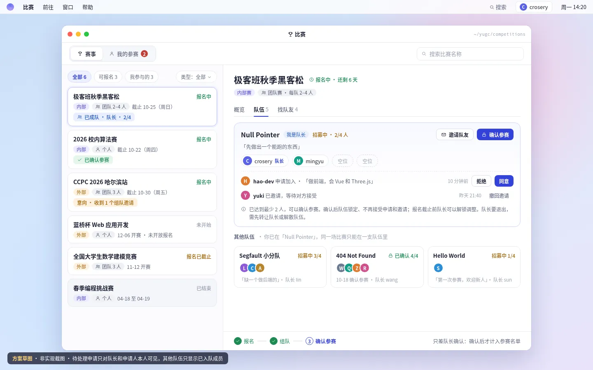
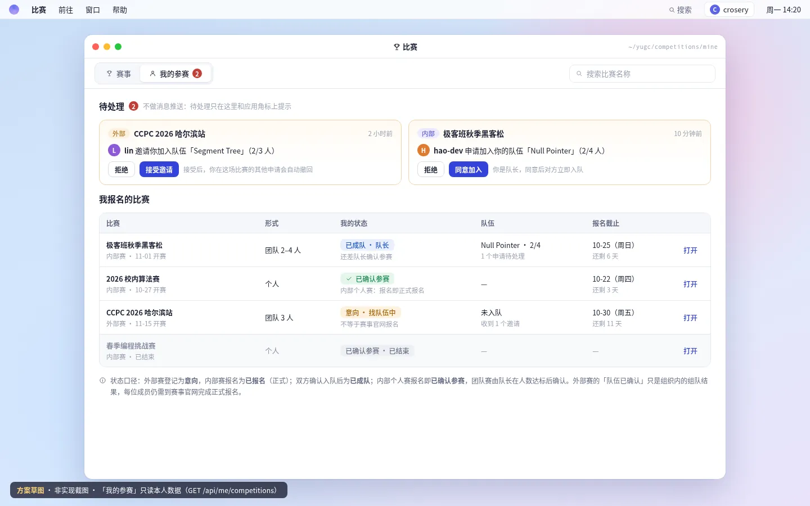
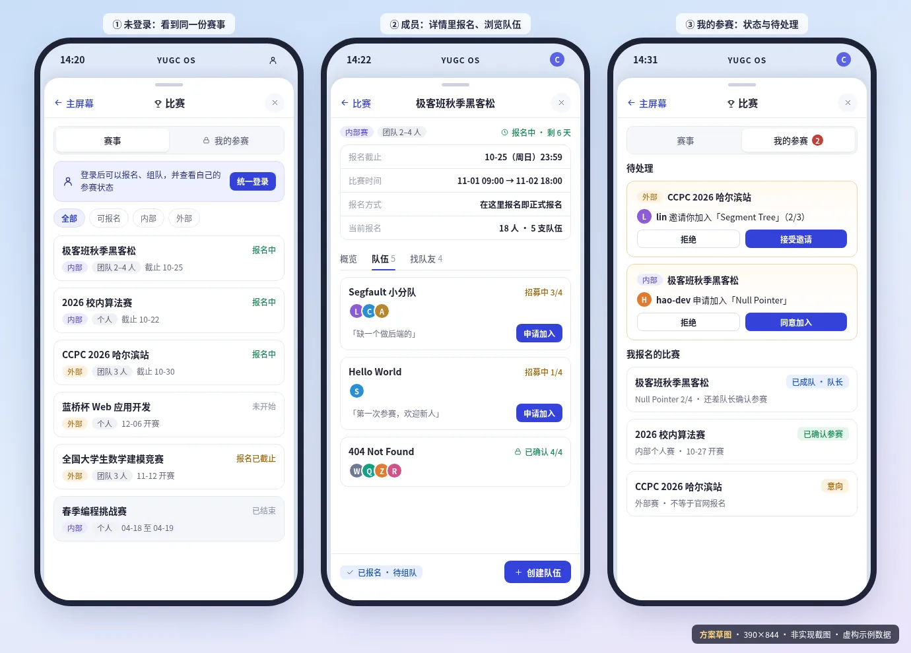

# 比赛应用：报名、组队与我的参赛方案

> #239 的目标方案（未实施）：把官网「比赛」窗口升级为「赛事 / 我的参赛」两个视图的应用——所有人看到同一份赛事，极客班成员在上面叠加自己的报名、组队与参赛状态；参赛者按极客班统一账号（`account_id`）识别，不按 GitHub 账号；同时约定接口、业务规则、数据库草图、控制台报名名单，以及与后端草稿 90fc376 的对齐清单。

状态：`proposed`（未实施，待所有者确认后开工）· 更新：2026-10-19 · 适用：`app/web/sites/portal` 比赛窗口、`app/server` 报名与组队接口及表、`app/console` 报名设置与名单

本文只是提议：下面的接口、表和界面都**还不存在**，现行行为以 [portal 合同](../services/web/portal.md#比赛窗口238) 和 [server 合同](../services/server/README.md) 为准。文中图片都是**方案草图**（静态 HTML 渲染，数据虚构），不是实现截图。

## 现状（#238 已有什么）

- 比赛由控制台登记（能力 `competitions.manage`，`app/server/src/lib/roles.ts:87`），官网匿名读 `GET /api/public/competitions`；`competitions` 表（`app/server/src/lib/db.ts:188`）只有赛事信息，没有报名、队伍或成员数据。
- 状态现算：`competitionStatus`（`app/server/src/lib/competition-store.ts:59`）按「已结束 → 报名中 → 进行中 → 未开始 / 报名已截止」判断；**没有报名截止时间的比赛永远不会进入「报名中」**。
- 官网窗口是只读列表：`Competitions()`（`app/web/sites/portal/components/os/Windows.tsx:216`，窗口宽 780），只能按「全部 / 内部 / 外部」筛；应用注册在 `app/web/sites/portal/lib/osApps.ts:46`。
- 登录今天只有 GitHub 一种，会话里没有统一账号；所有者 2026-10-19 明确登录改为「长江大学极客班统一登录」，GitHub、Google、邮箱验证码都是绑定到同一账号的登录方式（[PR #242](https://github.com/Yangtze-University-Geek-Class/admin/pull/242) 的 ADR-0005，`proposed`，未实施）。
- 缺的是：报名、组队、「我报名了哪些比赛」、待处理的邀请与申请，以及组织者看名单。Yuminghuang738 在 fork 分支 `task/239/competition_signup` 有一版后端草稿（提交 `90fc376`，基于 #243 的旧提交 `a42272d6`，未开 PR），差异见文末[对齐清单](#与后端草稿-90fc376-的对齐清单)。

## 目标、约束与不做

目标：

1. **一个应用，两个视图**：「赛事」是所有人同一份列表与详情；「我的参赛」只属于登录成员——报名了什么、在哪个队、有什么要处理。
2. **报名 → 组队 → 确认参赛**三步在详情底部的操作条上依次完成，任何时刻只给当前能做的主操作。
3. 组织者在控制台按比赛开放报名、设定个人或团队与每队人数，并查看、导出名单。

约束：

- 规则全部在服务端执行（时间窗口、一人一队、人数上下限、可见性），前端只负责呈现，按钮依据接口返回的可执行操作显示。
- 只新增表，不改 #238 `competitions` 表结构；参赛者按极客班账号 `account_id`（ADR-0005 的 `users.id`）识别，不按 GitHub 登录名或 GitHub id，用哪种方式登录都是同一个人。
- 依赖 ADR-0005 交付第 1 项「统一账号与登录」：会话里有 `account_id` 之后再开放报名，不先做以 GitHub id 为键的过渡版（省掉一次数据迁移，见[待确认](#待所有者确认) 7）。
- 所有状态变化只改状态、记时间和操作人，不物理删除记录。

不做（第一版）：

- 不收集手机号、QQ、微信、邮箱等联系方式；队内沟通走 GitHub 或线下。
- 不做推送、邮件或站内信：应用打开、窗口重新聚焦和每次操作后刷新，「我的参赛」用角标提示待处理数。
- 不替外部比赛办理官网报名，也不做「我已在官网报名」自报（见[待确认](#待所有者确认) 4）。
- 不做跨比赛的个人主页、积分或获奖记录。

## 结构与呈现

### 桌面：赛事


- 窗口加宽到约 1100px（现为 780）。工具栏左侧是「赛事 / 我的参赛」分段控件，后者带待处理角标；右侧是搜索。
- 左侧列表：「全部 / 可报名 / 我参与的」快捷筛选加类型下拉（内部、外部、个人、团队）。卡片显示名称、状态、内外部、个人或团队人数、截止日期；登录成员的卡片多一行**我的状态**，如「已报名 · 待组队」「意向 · 收到 1 个组队邀请」。
- 右侧详情：标题与状态、要点四格（报名截止、比赛时间、报名方式、当前报名）、团队赛规则提示，页签「概览 / 队伍 / 找队友」（个人赛只有概览）。
- 底部操作条：左边是三步进度（个人赛只有「报名」一步），右边是当前唯一的主操作与次要操作——未报名时「报名」，已报名未入队时「创建队伍 / 浏览队伍」，队长人数达标时「确认参赛」。截止后操作条只读，显示最终结果。

### 桌面：队伍页签



- 我的队伍置顶：队名、口号、在队成员与空位、招募状态和人数。队长看得到收到的申请（同意 / 拒绝）和自己发出的邀请（可撤回），以及「邀请队友」「确认参赛」。
- 其他队伍只显示在队成员、人数和状态；招募中且未满的队伍有「申请加入」。
- 「找队友」列出已报名、勾选了「在找队伍」且尚未入队的成员和他们自己写的备注，队长可以直接邀请。

### 桌面：我的参赛



- 「待处理」：收到的组队邀请、我当队长的队伍收到的申请，在卡片里直接处理；数量就是分段控件上的角标。
- 「我报名的比赛」：比赛、形式、我的状态（按下文口径）、队伍、截止时间，「打开」回到赛事详情；已结束的保留为历史。

### 手机



沿用现有手机主屏的 sheet：顶部分段控件切换两个视图；在赛事列表点进去推入详情，操作条固定在底部；「我的参赛」把表格换成卡片。390×844 下不得出现横向滚动。

### 控制台：报名设置与名单


- 比赛列表每行加「名单」入口，进入名单页：统计卡（报名人数、队伍、确认参赛、未成队）、页签（报名成员 / 队伍 / 未成队 / 已取消）、「报名设置」和「导出 CSV」。
- 「报名设置」对话框：开放报名、个人或团队、每队人数上下限。没有报名截止时间的比赛不能开放报名。

### 不同身份看到什么

| 身份 | 赛事列表与详情 | 报名人数与队伍 | 操作条 | 我的参赛 |
|---|---|---|---|---|
| 未登录 | 全部可看 | 不显示 | 「登录后可报名」+「统一登录」（进 `/signin?return_to=…`） | 登录提示 |
| 已登录、成员资格待核验 | 全部可看 | 不显示 | 「需要用 GitHub 重新验证成员资格」或「暂时无法核验，请稍后重试」 | 同左 |
| 极客班成员 | 全部可看，卡片带我的状态 | 显示 | 按规则 | 可用 |
| 组织者（`competitions.manage`） | 同成员 | 同成员 | 同成员 | 同成员；名单与导出在控制台 |

按 ADR-0005 决策 4，不是组织成员的人拿不到会话；如果所有者放开建号范围（ADR-0005 待确认 1），非成员账号与「资格待核验」一样只读，提示「报名与组队只对极客班成员开放」。

界面规则沿用现有约定：取消报名、解散、转让、撤销确认要二次确认并在关闭后归还焦点；不可用的操作写明原因，不放点不动的按钮；控制台不用原生下拉框和复选框。

## 业务规则

### 报名设置（组织者）

| 字段 | 取值 | 规则 |
|---|---|---|
| `enabled` | 开 / 关，默认关 | 开启要求比赛有报名截止时间；关闭后已有数据保留，写操作返回 `signup_not_enabled` |
| `participation` | `individual` 个人 / `team` 团队 | 有未取消的报名后不能再改 |
| `team_min` / `team_max` | 1 ≤ min ≤ max ≤ 20，仅团队赛 | max 不能小于任何未解散队伍的在队人数，min 不能大于任何已确认队伍的人数 |

对 #238 现有比赛接口的配套约束：有未取消的报名后不能改「内部 / 外部」；开放报名期间不能清空报名截止时间；有报名记录的比赛不能删除，只能下线。下线后官网整场隐藏（含「我的参赛」）、门户接口返回 404，记录保留，重新上线即恢复。

### 什么时候能写

`可写 = 已开放报名 且 competitionStatus(now) === "registering"`，也就是报名截止前、比赛结束前。报名、取消、建队、申请、邀请、处理、退出、转让、解散、确认与撤销确认**全部**受这一条约束；截止后整场冻结为只读，截止那一刻的状态就是最终名单。未开放时返回 `409 signup_not_enabled`，不在报名中返回 `409 signup_closed`。

### 报名

- 只有极客班成员能报名：统一登录判定为组织 active 成员的账号，不论这次用 GitHub、Google 还是邮箱验证码登录。一人一场一条记录，按 `account_id` 识别。
- 报名可附 200 字以内的备注（极客班成员和组织者都看得到，填写处提示不要写联系方式）；团队赛可勾选「在找队伍」，出现在「找队友」里。
- 重复报名是幂等的：已报名时只更新备注和勾选，已取消时恢复报名。
- 取消报名：普通队员自动退出队伍；队长且队里还有别人时先转让或解散（`409 is_team_leader`）；队伍已确认时先撤销确认（`409 team_locked`）；只有自己一人的队伍随之解散。自己发出和收到的待处理申请、邀请一并关闭。
- 外部比赛的报名在本系统里叫**意向**，用来找人组队和统计，不等于在比赛官网报名；内部比赛的报名就是正式报名。

### 组队（仅团队赛）

- **建队**：须已报名、不在任何队伍。队名 trim 后 2–30 个字符（按 Unicode 字符计，与 #238 比赛名称同口径），同一比赛未解散的队伍不能重名（trim + NFKC + 小写后比较）；口号 60 字以内；建队人即队长。
- **加入只有两条路，都要双方同意**：成员申请（可附 100 字以内的话）后队长同意；或队长邀请已报名、未入队的成员，对方接受。申请人可撤回申请，队长可撤回邀请。
- **一人一队**：同一场比赛一个人最多在一支队伍里。入队成功时，这个人在本场的其他待处理申请和邀请自动关闭。
- **人数**：在队人数不超过 `team_max`；满员时其余待处理申请和邀请自动关闭。
- **退出与解散**：队员可以退出；队长不能直接退出，要先把队长转让给在队成员，或者解散队伍。解散后成员回到「已报名、未入队」。队长移出队员放在 P2。
- **确认参赛（锁定）**：在队人数在 `[team_min, team_max]` 内时队长可以确认；确认后不再接受申请和邀请，成员不能退出或被移出，待处理项自动关闭。截止前队长可以撤销确认回到招募中。截止时没有确认的队伍**不计入参赛名单**（见待确认 1）。

### 个人状态口径

「我的状态」由报名、队伍和比赛类型现算，不单独存储。接口返回 `state`，前端按比赛内外部换成文案：

| 情况 | `state` | 内部比赛 | 外部比赛 |
|---|---|---|---|
| 未报名 | `none` | 未报名 | 未报名 |
| 个人赛已报名 | 内部 `confirmed` / 外部 `signed_up` | **已确认参赛** | 意向 |
| 团队赛已报名、未入队 | `signed_up` | 已报名 · 待组队 | 意向 · 找队伍 |
| 已入队、队伍招募中 | `in_team` | 已成队 · 待确认 | 已成队 |
| 队伍已确认 | `confirmed` | **已确认参赛** | 队伍已确认（以官网报名为准） |
| 截止时未入队或队伍未确认 | `unplaced` | 未成队 · 未计入名单 | 未成队 |

有待处理事项时附在后面，例如「意向 · 收到 1 个组队邀请」。

### 可见性与隐私

- 匿名访客和非成员只看得到赛事信息和报名设置（个人或团队、人数），看不到报名人数、队伍和任何成员（见待确认 3）。
- 极客班成员看得到：统计数字、各队的**在队**成员（账号的显示名和头像；按 ADR-0005 现阶段就是绑定的 GitHub 登录名和头像，不显示 Google 昵称或邮箱）、「找队友」列表和备注。待处理的申请和邀请**只给队长和当事人**，被拒绝、撤回、退出的历史不出现在门户里。
- 组织者在控制台看完整名单（含已取消和历史状态）；导出 CSV 写审计 `competition.roster.export`（比赛 id 与导出行数），单元格沿用 `csvCell`（`app/server/src/routes/console/applications.ts:32`）防公式注入。
- 门户的自助操作不写审计日志，靠行内的时间与操作人追溯；报名设置的修改与 #238 的比赛写入一样，与审计在同一事务里。

### 统计口径

| 数字 | 口径 |
|---|---|
| 报名人数 | 未取消的报名数（外部赛叫「意向人数」） |
| 队伍 | 未解散的队伍数；其中「已确认」为已锁定的队伍 |
| 确认参赛人数 | 内部个人赛 = 报名人数；团队赛 = 已确认队伍的在队人数之和；外部赛叫「队伍已确认人数」，不出现在个人赛 |
| 未成队 | 团队赛中已报名、不在任何队伍的人数 |

## 接口

门户接口都要求登录（`401 not_signed_in`）且是极客班成员（`403 not_member`）；成员资格由统一登录的资格校验给出（ADR-0005 决策 6，草稿里的 `requireOrgMember` 改为调用它），比赛模块不自己查 GitHub，资格待核验或暂不可用时原样返回 `403 membership_verification_required`、`503 membership_unavailable`；写接口每人每分钟 60 次。比赛、队伍或成员关系不存在，或比赛已下线，一律 404。「相对草稿」一列对照 90fc376。

| 方法与路径 | 谁 | 作用 | 相对草稿 |
|---|---|---|---|
| `GET /api/public/competitions` | 匿名 | 每场比赛增加 `signup: { enabled, participation, team_min, team_max }`，不含人数 | #238 接口加字段 |
| `GET /api/me/competitions` | 成员 | 我报名的比赛（状态、队伍）+ 待处理列表与数量，供「我的参赛」和角标 | 新增 |
| `GET /api/competitions/:id/my-status` | 成员 | 我在这场的报名、队伍、待处理、`state`、可执行操作和本场统计 | 沿用，改按 account_id |
| `POST /api/competitions/:id/signup` | 成员 | 报名或更新 `{ note?, looking_for_team? }`，幂等 | 调整：去掉 contact |
| `DELETE /api/competitions/:id/signup` | 成员 | 取消报名（规则见上） | 调整：改状态不删行 |
| `GET /api/competitions/:id/teams` | 成员 | 未解散队伍、在队成员与人数；队长额外看到本队待处理项 | 调整：不给他人待处理与被拒记录 |
| `GET /api/competitions/:id/free-agents` | 成员 | 已报名、在找队伍、未入队的人和备注 | 新增 |
| `POST /api/competitions/:id/teams` | 成员 | 建队 `{ name, slogan? }`；个人赛返回 `409 individual_competition` | 调整：去掉 maxMembers，不隐式报名 |
| `POST /api/teams/:id/apply` | 成员 | 申请加入 `{ message? }` | 沿用，不隐式报名 |
| `POST /api/teams/:id/invite` | 队长 | 邀请 `{ account_id }`，对方须已报名本场且未入队 | 调整：不再收 login |
| `POST /api/teams/:id/respond` | 队长或当事人 | `{ membership_id, action: accept \| decline \| withdraw }` | 调整：校验归属与角色，reject 改为 decline |
| `POST /api/teams/:id/leave` | 队员 | 退出；队长返回 `409 is_team_leader` | 调整：队长退出不再等于解散 |
| `POST /api/teams/:id/transfer` | 队长 | 转让队长 `{ account_id }` | 新增 |
| `DELETE /api/teams/:id` | 队长 | 解散 | 新增 |
| `POST /api/teams/:id/lock`、`DELETE /api/teams/:id/lock` | 队长 | 确认参赛、撤销确认 | 新增 |
| `PATCH /api/teams/:id`（P2） | 队长 | 改队名、口号 | 新增 |
| `DELETE /api/teams/:id/members/:account_id`（P2） | 队长 | 移出队员 | 新增 |
| `PUT /api/console/competitions/:competition_id/signup-settings` | `competitions.manage` | 报名设置，写审计 | 新增 |
| `GET /api/console/competitions/:competition_id/roster` | `competitions.manage` | 设置、统计、全部报名与队伍（含已取消） | 调整：去 contact，按 account_id |
| `GET /api/console/competitions/:competition_id/roster.csv` | `competitions.manage` | 导出名单，写审计 | 调整：去 contact 列，加审计 |
| `PATCH`、`DELETE /api/console/competitions/:competition_id` | `competitions.manage` | #238 现有接口，加上「报名设置」一节的配套约束 | #238 接口加校验 |

主要响应形状（字段名为建议，实施时以 `contracts.ts` 的 Schema 为准）：

```ts
type State = "none" | "signed_up" | "in_team" | "confirmed" | "unplaced";
type Member = { account_id: string; name: string; avatar_url: string | null };  // 名字和头像读取时取自账号
type PendingItem = {
  membership_id: string;
  type: "applied" | "invited";
  direction: "incoming" | "outgoing";      // 等我处理 / 我发出、等对方处理
  team: { id: string; name: string; member_count: number };
  user: Member;                             // 对方：邀请我的队长，或申请加入我队的人
  message: string;
  created_at: number;
};

// GET /api/competitions/:id/my-status
type MyStatus = {
  writable: boolean;                        // 已开放报名且在报名中
  state: State;
  signup: { note: string; looking_for_team: boolean; created_at: number } | null;
  team: { id: string; name: string; status: "recruiting" | "locked"; role: "leader" | "member"; member_count: number } | null;
  pending: PendingItem[];
  actions: string[];                        // 当前可执行操作，如 signup、cancel_signup、create_team、lock、unlock
  stats: { signups: number; teams: number; confirmed_teams: number; confirmed_participants: number; unplaced: number };
};

// GET /api/competitions/:id/teams
type Teams = {
  teams: {
    id: string; name: string; slogan: string;
    status: "recruiting" | "locked";
    leader: Member;
    members: (Member & { role: "leader" | "member" })[];  // 只含在队成员
    member_count: number;
    my_relation: "none" | "applied" | "invited" | "member" | "leader";
    can_apply: boolean;
    pending?: PendingItem[];                // 只有本队队长能看到
  }[];
};

// GET /api/me/competitions
type MyCompetitions = {
  pending_count: number;                    // 只数 incoming
  pending: (PendingItem & { competition: { id: string; name: string } })[];
  competitions: { competition: PublicCompetition; state: State; team: MyStatus["team"]; signed_up_at: number }[];
};
```

错误码（`{ error }` 形状与现有接口一致）：

| 状态码 | `error` | 场景 |
|---|---|---|
| 400 | 字段级错误，如 `bad_note`、`bad_team_name`、`bad_slogan`、`bad_team_size` | 输入不合法 |
| 401 | `not_signed_in` | 未登录 |
| 403 | `not_member`、`membership_verification_required`、`not_team_leader`；控制台沿用 `requireCapability` | 不是极客班成员；成员资格需用 GitHub 重新验证（ADR-0005）；非队长做队长操作；缺能力 |
| 404 | `not_found` | 比赛、队伍、成员关系不存在，比赛已下线，或成员关系不属于路径上的队伍 |
| 409 | `signup_not_enabled`、`signup_closed` | 未开放报名；不在报名中 |
| 409 | `not_signed_up`、`individual_competition` | 需要先报名；个人赛不能建队 |
| 409 | `already_in_team`、`already_applied`、`already_invited`、`invitee_not_signed_up` | 本人或对方已在队；已有待处理申请或邀请；被邀请人未报名本场 |
| 409 | `team_full`、`team_too_small`、`team_locked`、`duplicate_team_name` | 满员；人数不够不能确认；已确认不能变更；队名重复 |
| 409 | `is_team_leader`、`invalid_state` | 队长须先转让或解散；申请或邀请已被处理 |
| 409 | `competition_has_signups`、`signup_deadline_required`、`team_size_conflict` | 控制台：有报名后改类型或删除；开放报名缺截止时间；改人数会让现有队伍越界 |
| 429 | 沿用现有限流 | 写操作超限 |
| 503 | `membership_unavailable` | 成员资格暂时查不到（ADR-0005），可重试 |

## 数据库（草图）

只新增表，不改 #238 的 `competitions`：报名设置单独一张 1:1 表，没有行就是未开放报名，旧数据行为不变，回滚也不用动表。所有写操作在 `db.transaction` 里重新读状态再写，唯一索引兜底并发，冲突映射为对应的 409。主键沿用 `randomUUID()`，时间为毫秒时间戳，外键依赖已开启的 `foreign_keys = ON`。

```sql
CREATE TABLE IF NOT EXISTS competition_signup_settings (
  competition_id TEXT PRIMARY KEY REFERENCES competitions(id) ON DELETE CASCADE,
  enabled INTEGER NOT NULL DEFAULT 0 CHECK (enabled IN (0, 1)),
  participation TEXT NOT NULL CHECK (participation IN ('individual', 'team')),
  team_min INTEGER,
  team_max INTEGER,
  updated_at INTEGER NOT NULL,
  updated_by TEXT NOT NULL,                 -- 操作人的 account_id
  CHECK ((participation = 'individual' AND team_min IS NULL AND team_max IS NULL)
      OR (participation = 'team' AND team_min BETWEEN 1 AND 20 AND team_max BETWEEN team_min AND 20))
);

CREATE TABLE IF NOT EXISTS competition_signups (
  id TEXT PRIMARY KEY,
  competition_id TEXT NOT NULL REFERENCES competitions(id) ON DELETE CASCADE,
  account_id TEXT NOT NULL REFERENCES users(id),  -- 极客班账号（ADR-0005）：身份键
  status TEXT NOT NULL CHECK (status IN ('active', 'cancelled')),
  looking_for_team INTEGER NOT NULL DEFAULT 0 CHECK (looking_for_team IN (0, 1)),
  note TEXT NOT NULL DEFAULT '' CHECK (length(note) <= 200),
  created_at INTEGER NOT NULL,
  updated_at INTEGER NOT NULL,
  cancelled_at INTEGER,
  UNIQUE (competition_id, account_id)
);
CREATE INDEX IF NOT EXISTS idx_competition_signups_account ON competition_signups(account_id);

CREATE TABLE IF NOT EXISTS competition_teams (
  id TEXT PRIMARY KEY,
  competition_id TEXT NOT NULL REFERENCES competitions(id) ON DELETE CASCADE,
  name TEXT NOT NULL,
  name_key TEXT NOT NULL,                   -- trim + NFKC + 小写，用于查重
  slogan TEXT NOT NULL DEFAULT '',
  leader_account_id TEXT NOT NULL REFERENCES users(id),
  status TEXT NOT NULL CHECK (status IN ('recruiting', 'locked', 'disbanded')),
  locked_at INTEGER,
  disbanded_at INTEGER,
  created_at INTEGER NOT NULL,
  updated_at INTEGER NOT NULL
);
CREATE UNIQUE INDEX IF NOT EXISTS uq_competition_teams_name
  ON competition_teams(competition_id, name_key) WHERE status <> 'disbanded';
CREATE INDEX IF NOT EXISTS idx_competition_teams_competition ON competition_teams(competition_id, status);

CREATE TABLE IF NOT EXISTS competition_team_members (
  id TEXT PRIMARY KEY,                      -- 即 membership_id
  team_id TEXT NOT NULL REFERENCES competition_teams(id) ON DELETE CASCADE,
  competition_id TEXT NOT NULL REFERENCES competitions(id) ON DELETE CASCADE,
  account_id TEXT NOT NULL REFERENCES users(id),
  role TEXT NOT NULL CHECK (role IN ('leader', 'member')),
  status TEXT NOT NULL CHECK (status IN
    ('applied', 'invited', 'active', 'declined', 'withdrawn', 'left', 'removed', 'disbanded')),
  message TEXT NOT NULL DEFAULT '' CHECK (length(message) <= 100),
  created_by TEXT NOT NULL,                 -- 发起人的 account_id
  decided_by TEXT,
  created_at INTEGER NOT NULL,
  decided_at INTEGER,
  updated_at INTEGER NOT NULL
);
-- 一人一队：同一场比赛只能有一条在队记录
CREATE UNIQUE INDEX IF NOT EXISTS uq_team_members_active
  ON competition_team_members(competition_id, account_id) WHERE status = 'active';
-- 同一支队伍对同一个人只能有一条待处理记录；处理完的历史行保留，可以再次申请
CREATE UNIQUE INDEX IF NOT EXISTS uq_team_members_pending
  ON competition_team_members(team_id, account_id) WHERE status IN ('applied', 'invited');
CREATE INDEX IF NOT EXISTS idx_team_members_team ON competition_team_members(team_id, status);
CREATE INDEX IF NOT EXISTS idx_team_members_account ON competition_team_members(account_id, status);
```

迁移与回滚：

- 启动时 `CREATE TABLE IF NOT EXISTS` / `CREATE INDEX IF NOT EXISTS`，与 `db.ts` 现有做法一致；`tests/server/legacy-database.test.ts` 补「没有这四张表的旧库」重启用例。
- 身份键是会话里的极客班账号 `account_id`（ADR-0005：128 位随机、永不复用）。GitHub 改名、改用 Google 或邮箱验证码登录都还是同一个人；显示名和头像读取时从账号取，比赛表不存登录名快照，被别人复用的旧 GitHub 登录名也认领不到记录。
- 这几张表引用 `users(id)`，所以排在 ADR-0005 第 1 项之后建表。账号合并（ADR-0005 的 `POST /api/identity/merge`）时在同一事务里把这几张表的 `account_id` 改到目标账号；同一场比赛两边都有报名或在队记录时合并回 409，由本人先取消其中一边。
- 回滚运行代码时保留新表和数据（旧代码不读），不删数据，不移动发布 tag。

## 前端落点

portal（`app/web/sites/portal`）：

| 位置 | 内容 |
|---|---|
| `components/os/competitions/CompetitionsApp.tsx` | 视图切换、加载与聚焦刷新、身份判断 |
| `components/os/competitions/CompetitionList.tsx`、`CompetitionDetail.tsx` | 列表筛选与搜索；详情和页签 |
| `components/os/competitions/TeamsPanel.tsx`、`FreeAgents.tsx` | 队伍与找队友 |
| `components/os/competitions/MyCompetitions.tsx` | 我的参赛与待处理 |
| `components/os/competitions/ActionBar.tsx` | 三步进度与主操作，按接口返回的 `actions` 渲染 |
| `lib/competition-signups.ts` | 接口调用、响应形状校验、状态文案（与「个人状态口径」表一一对应） |
| `components/os/Windows.tsx` | 比赛窗口改为渲染 `CompetitionsApp`、宽约 1100；现有时间、状态与排序逻辑（`lib/competitions.ts` 的 `statusAt`、北京时间格式、60 秒重算）原样复用 |
| `styles/os.css` | 新样式；手机 sheet 复用现有容器 |

console（`app/console`）：`pages/Competitions.vue` 每行加「名单」；新增 `pages/CompetitionRoster.vue`（统计、页签、报名设置对话框、导出）；`router.ts` 加路由；权限沿用 `competitions.manage`。后端合并前可先对 `app/web/shared/lib/mock-api.ts` 与控制台样板开发。

## 验证与验收

实施时补齐（文件名为建议）：

- server `tests/server/competition-signups.test.ts`：真实 HTTP 的 401/403/404；时间窗口（未开放、截止前后、已结束）；报名幂等与取消联动；建队、申请、邀请、处理、退出、转让、解散、确认的全流程；一人一队与满员的并发兜底；待处理只对队长和当事人可见；统计口径；名单导出的 CSV 注入防护与审计；#238 PATCH 和 DELETE 的新增约束。
- web `tests/web/portal-competition-app.test.tsx`：四种身份的呈现、状态文案表、操作条按 `actions` 渲染、截止后只读、加载失败与空态。
- console `tests/console/competition-roster.test.ts`：报名设置校验与冲突提示、页签与统计、导出。
- e2e `tests/e2e/competition-app.spec.mts`：1440×900 与 390×844 下走完「报名 → 建队 → 邀请 → 接受 → 确认参赛」，手机无横向溢出。
- 人工验收：两个账号在本机隔离服务上让一支队伍从报名走到确认，截止后名单冻结；外部赛只出现「意向 / 队伍已确认」。
- 本文自身只需 `pnpm check:docs` 通过。

## 与后端草稿 90fc376 的对齐清单

| # | 草稿现状 | 方案 | 级别 |
|---|---|---|---|
| 1 | 报名、队伍、成员都以 `github_login` 为键 | 以极客班账号 `account_id` 为键（依赖 ADR-0005 第 1 项），不存登录名快照 | 必改 |
| 2 | 邀请接受任意 `login`，`userId` 由客户端传 | 只收 `account_id`；对方须已报名本场、未入队 | 必改 |
| 3 | 报名只在报名中，但建队、申请、邀请、接受到比赛结束前都能做，建队和申请还会隐式补报名 | 所有写操作统一「已开放报名且报名中」，不隐式报名，截止后冻结 | 必改 |
| 4 | `GET teams` 向所有成员返回待处理和被拒的成员；报名与 CSV 含 `contact` | 只返回在队成员，待处理只给队长和当事人；去掉 contact | 必改 |
| 5 | 队长建队时自填 `maxMembers`（1–20），个人赛也能建队 | 组织者在报名设置里定个人或团队与人数，个人赛不能建队 | 必改 |
| 6 | `respond` 不校验成员关系属于路径上的队伍 | 校验 `membership.team_id === :id`，并按角色限制 accept、decline、withdraw | 必改 |
| 7 | 取消、退出、解散物理删除；队长退出即解散并删除全部成员 | 只改状态、记时间和操作人；队长先转让或显式解散 | 必改 |
| 8 | 内部团队赛把所有报名都算作确认参赛 | 按个人或团队区分口径（见统计口径） | 必改 |
| 9 | 名单导出不写审计 | 写 `competition.roster.export` | 必改 |
| 10 | 满员自动置为 confirmed | 队长在人数达标后显式确认，截止前可撤销 | 建议（待确认 1） |
| 11 | 报名行存 registered / intent | 只存 active / cancelled，意向与否由比赛内外部决定 | 建议 |
| 12 | 状态冲突多返回 400 | 状态冲突统一 409 与稳定错误码，输入错误才 400 | 建议 |
| 13 | 没有「我的参赛」和「找队友」 | 新增 `GET /api/me/competitions`、`GET /api/competitions/:id/free-agents` | 建议 |

## 交付拆分

1. **#243（#238）**：只做比赛信息发布；本方案和草图以 `proposed` 随它入库，不改运行代码。
2. **前置：统一账号**：ADR-0005 第 1 项（#237 方案确认后实施）。在它之前只上线 #238 的赛事浏览。
3. **#239 后端**：Yuminghuang738 按对齐清单调整 90fc376，待 #243 合并、统一账号可用后基于最新 `stage` 开 PR，同步 API、数据模型、接口行为契约和 server 合同。
4. **#239 前端**：portal 比赛应用与控制台报名设置、名单（实施人待定；是否另开 `ui:*` issue 由所有者决定）。
5. 两部分落地后，本文压缩为实施结论，现行契约迁回 `docs/services/*`。

## 待所有者确认

1. 团队赛是否保留队长「确认参赛」锁定。推荐保留：截止前名单就是确定的；不保留则截止时人数达标的队伍自动视为确认。
2. 名单权限复用 `competitions.manage`（推荐），还是新增只读的 `competitions.roster`。
3. 匿名访客不显示报名人数和队伍数（推荐），还是公开这些数字。
4. 外部比赛第一版不做「已在官网报名」自报（推荐），以后需要再加一个本人勾选的标记。
5. 交付顺序与实施人：后端由 Yuminghuang738 调整后先开 PR；前端由谁做、是否拆 issue。
6. 本方案与草图随 #243 入库（当前做法），还是只留在 #239 的讨论里。
7. 如果报名必须先于统一账号上线：临时以 GitHub 数字 id 记录，统一账号落地时按 ADR-0005 的迁移规则回填并切到 `account_id`。不推荐：多一次迁移和一段双口径。

## 来源

- 需求：[issue #239](https://github.com/Yangtze-University-Geek-Class/admin/issues/239)；所有者 2026-10-19 对比赛窗口的反馈：不应只有「内部 / 外部 / 全部」，要做成包含报名信息、组队信息和已报名赛事的应用。
- 现有实现：`app/server/src/lib/competition-store.ts:59`、`app/server/src/lib/db.ts:188`、`app/server/src/lib/roles.ts:87`、`app/web/sites/portal/components/os/Windows.tsx:216`、`app/web/sites/portal/lib/osApps.ts:46`。
- 后端草稿：fork `Yuminghuang738/admin` 分支 `task/239/competition_signup` 的提交 `90fc376`（基于 `a42272d6`，未开 PR）：`app/server/src/lib/competition-signup-store.ts`、`app/server/src/routes/portal/competition-signups.ts`、`app/server/src/routes/console/competition-roster.ts`。
- 身份：[PR #242](https://github.com/Yangtze-University-Geek-Class/admin/pull/242) 中的 ADR-0005（`proposed`）；所有者 2026-10-19：「我们的登录不再是github登录了，是长江大学极客班统一登录的」，GitHub、Google、邮箱验证码都绑定到同一个极客班账号。
- 草图：`docs/assets/competition-app/*.webp`，由静态 HTML 渲染，数据虚构。